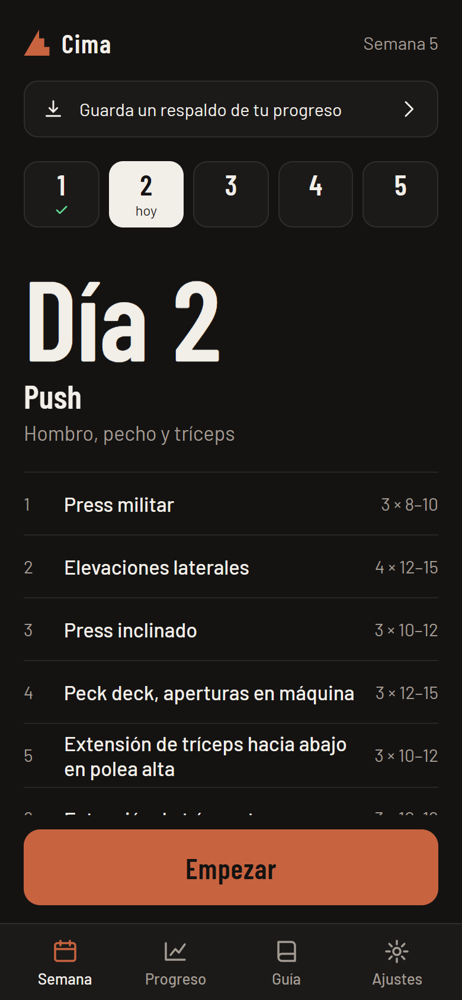
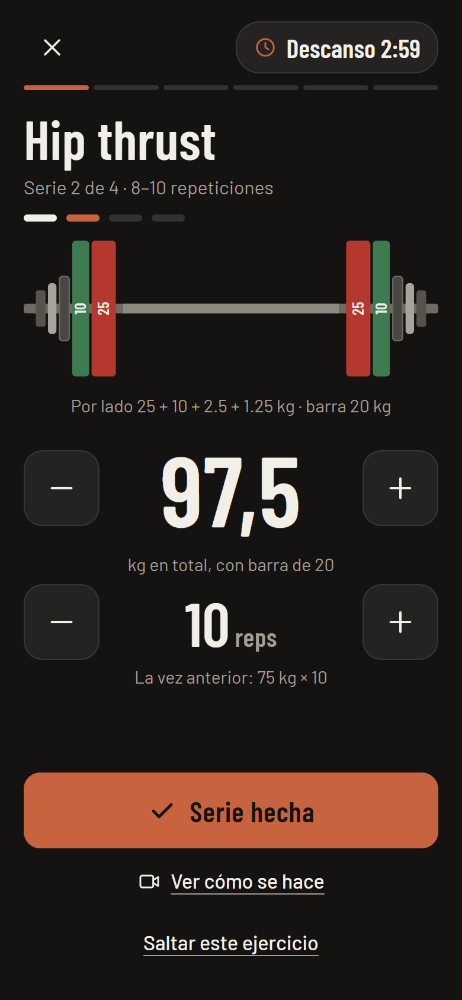
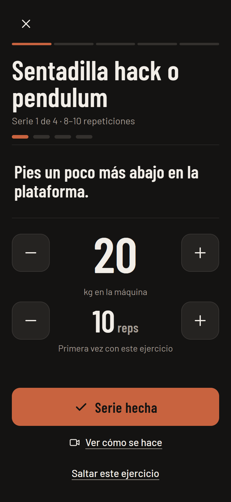
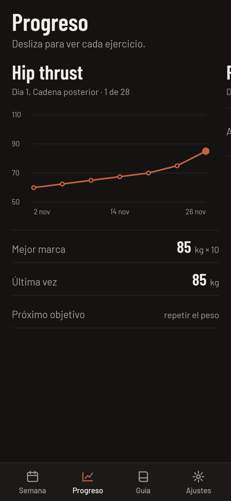
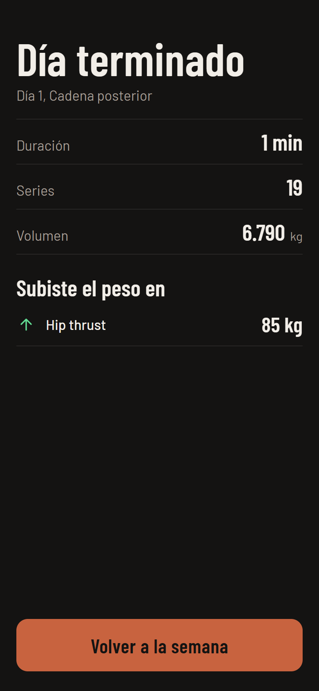

<p align="center">
  
</p>

<p align="center">
  <strong>Tu rutina de gimnasio, una serie a la vez.</strong><br>
  App instalable para iPhone y Android que guía el entrenamiento de 5 días, muestra cómo se hace cada ejercicio y guarda tu progreso.
</p>

<p align="center">
  
  
  
</p>

<p align="center">
  
  
  
  
  
</p>

## Qué hace

- **Rutina por días.** Cinco días con sus ejercicios, series y repeticiones. La app sugiere el día que toca.
- **Una serie a la vez.** Ajustas peso y repeticiones, tocas *Serie hecha* y sigues. Los valores vienen precargados de la vez anterior.
- **La barra, dibujada.** En los ejercicios con barra ves qué discos poner por lado, con los colores de competencia: 25 rojo, 20 azul, 15 amarillo, 10 verde, 5 blanco, 2,5 negro y 1,25 cromo.
- **Cómo se hace.** Video de YouTube por ejercicio, que no se descarga hasta que lo tocas, y tres pistas de técnica en lenguaje llano.
- **Descanso con temporizador.** Cuenta con hora de fin, así que sigue bien aunque bloquees el teléfono. Mantiene la pantalla encendida durante la sesión.
- **Aviso de subir peso.** Si completaste todas las series en el tope de repeticiones, sugiere el siguiente peso.
- **Progreso.** Gráfica por ejercicio, mejor marca y próximo objetivo.
- **Guía.** RIR, series, descanso, progresión y glosario.
- **Respaldo.** Exporta y restaura tu historial en un archivo.

Todo funciona sin conexión, salvo los videos. Los datos viven en el dispositivo (IndexedDB) y no se envían a ningún servidor.

## Instalar en el teléfono

| Dispositivo | Pasos |
|---|---|
| **iPhone** | Abre la app en Safari, toca Compartir y luego *Agregar a pantalla de inicio*. Instalada, tus datos quedan protegidos. |
| **Android** | En Chrome, menú y *Instalar app*. |

## Desarrollo

```powershell
cd app
npm install
npm run dev        # servidor local
npm test           # pruebas (vitest)
npm run build      # compila a app/dist
npm run preview    # sirve la compilación en :4173
```

Requiere Node 20 o superior.

### Cambiar la rutina

Todo el contenido está en [`app/src/data/routine.ts`](app/src/data/routine.ts): ejercicios, series, repeticiones, descanso, pistas y video de YouTube (`youtubeId`).

> No cambies el `id` de un ejercicio que ya tenga historial: el progreso se enlaza por ese `id`.

### Publicar

Es un sitio estático. En Cloudflare Pages, conecta este repositorio con:

| Ajuste | Valor |
|---|---|
| Root directory | `app` |
| Build command | `npm run build` |
| Output directory | `dist` |

Cada `push` a la rama principal se publica solo, y los teléfonos reciben la versión nueva la próxima vez que abran la app. El historial no se toca.

## Cómo está hecha

- **Stack:** Vite, TypeScript, Preact, `vite-plugin-pwa`, Dexie (IndexedDB). Gráficas y barra en SVG propio, sin librerías.
- **Tipografía:** Barlow Condensed y Barlow, autoalojadas.
- **Diseño:** grafito, hueso y terracota. Los discos de la barra son el único color rico de la app. El sistema completo está en [`DESIGN.md`](DESIGN.md).

## Estructura

```
app/            la PWA (src, public, scripts)
identidad/      logo, paleta, iconos y guía de marca
pantallas/      las tres direcciones visuales exploradas
docs/           capturas
DESIGN.md       sistema de diseño
PRODUCT.md      qué es el producto y para quién
PLAN.md         plan inicial y decisiones
```

---

<p align="center">
  Hecho por <a href="https://somospits.com.co">somospits.com.co</a>
</p>
